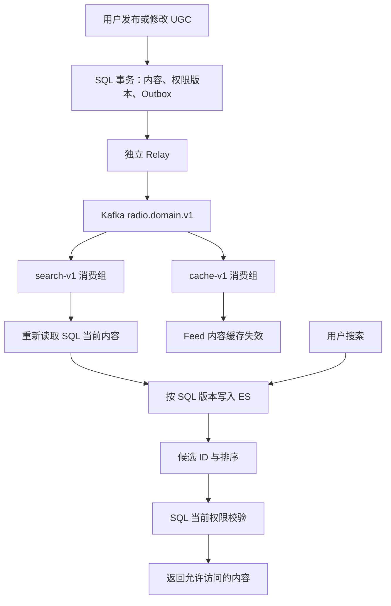

# Elasticsearch 与 Kafka 在项目中的实际使用

日期：2026-10-20。依据当前工作区源码和 Compose 配置整理；本轮只新增说明文档，未修改业务代码、读取私有凭据或操作运行环境。历史验收记录不代表今天的服务运行状态。

## 1. 职责与边界

主要实现位于 `recommend-radio/backend`，属于 Recommend Radio 业务层。

| 组件 | 实际职责 | 权威边界 |
| --- | --- | --- |
| SQL（Docker 配置为 MySQL，部分测试使用 SQLite） | 内容、权限、后台任务状态、Outbox、Inbox、聚合序号 | 业务事实来源 |
| Kafka | 投递后台任务和领域事件，隔离不同工作负载，支持独立消费者组 | 消息必须与 SQL 中的记录核验 |
| Elasticsearch | 站内内容全文搜索、输入联想、候选排序与分页 | 搜索投影，不决定权限 |
| Redis | 候选缓存和 Feed 缓存 | 缓存不能授予访问权限 |

ES 搜索与 B 站上游搜索是两条路径；ES 也不承担 AMEM 长期记忆的向量检索。AMEM 核心另有 FTS5 和向量后端实现（sqlite-vec / Qdrant）。

## 2. Kafka：任务与领域事实两条链路

`kafka_transport.py` 的 `lane_for()` 和 `KafkaSettings.topic()` 定义四个 topic，默认各 6 个分区：

| Topic | 用途 |
| --- | --- |
| `radio.jobs.v1` | 对话、发现、演化、关注同步等其他后台任务 |
| `radio.events.v1` | `behavior`、`sse`、`feed_projection`、`feed_asset_ready` 任务 |
| `radio.media.v1` | `media_import` 媒体任务 |
| `radio.domain.v1` | 内容创建、编辑、删除和权限变更等领域事件 |

这里 `events` 仍是 durable job 的执行队列，真正的领域事实进入 `domain`。

### 任务执行

1. 任务先写入 `durable_jobs`，保存输入、输入哈希、执行状态和重试信息。
2. Relay 通过发布租约领取待投递任务。MySQL 使用 `FOR UPDATE SKIP LOCKED`，网络发送发生在领取事务之外。
3. Kafka 中的任务信封只包含 `schemaVersion`、`jobId`、`kind`、`inputHash`；worker 从 SQL 读取实际输入，不直接信任 broker payload。
4. 有业务 lane 的任务使用 lane 哈希作为 partition key；无 lane 时使用 jobId 哈希。SQL 同时约束同 lane 的前后执行关系。
5. Worker 校验任务身份并获取执行租约；发布 token 和执行 token 独立，过期 token 不能确认新 owner 的工作。
6. 先持久化完成状态或安全重试状态，再手动提交 Kafka offset。重试有退避，不能安全重试的任务可进入 `needs_reconciliation`。

`KafkaConsumerLoop` 由 poll 线程管理消费者，每个分区最多一个在途任务，处理时暂停该分区。revoke/lost 时取消旧工作；assignment epoch 防止旧 owner 提交 offset，SQL lease token 防止旧执行覆盖新状态。

生产者开启 `enable.idempotence=true`、`acks=all` 并等待 delivery callback。但这些设置不构成 Kafka、SQL、ES 之间的原子事务。

### 领域事件投递

`ugc/service.py` 把 UGC 内容变更、版本、权限版本、命令幂等记录和 `domain_event_outbox` 写入同一个 SQL 事务。事件包括 `content.created`、`content.updated`、`content.deleted`、`content.visibility_changed`。

`DomainOutboxRelay` 的流程是：领取短租约 → 等待 Kafka broker 确认 → 使用当前发布 token 更新 SQL。broker 已确认、SQL 尚未标记 published 时崩溃，会产生重复消息；这正是消费者必须幂等的原因。

同一内容的事件使用相同 aggregate key 和递增 sequence；未发布的前驱事件阻止后继发布。消费者用 `(consumer_name, event_id)` Inbox 去重，并维护聚合消费 head，防止旧 sequence 回退投影进度。

两个独立消费者组订阅 `radio.domain.v1`：

- 默认 `radio.search-v1`：更新 ES 搜索投影。
- 默认 `radio.cache-v1`：使对应 Feed 内容缓存失效。

因为组不同，同一个事件会被这两个处理器分别消费。组内增加实例才是分摊分区处理。

## 3. Elasticsearch：检索内容，再由 SQL 授权

`content_search/elastic.py` 定义默认索引 `radio-content-v1`：

- 标题、正文使用 `text`；ID、来源、owner、scope、状态、类型使用 `keyword`。
- `completion` 使用 `search_as_you_type`，提供输入联想。
- 保存内容版本、权限版本、更新时间和 tombstone。
- 当前 mapping 为 strict，1 个主分片、0 个副本，没有单独配置中文 analyzer。

接口是 `GET /api/content/search` 和 `GET /api/content/suggest`，受 `CONTENT_SEARCH_ENABLED` 控制。

正式搜索使用 `multi_match` 查询 `title^3` 与 `body`，多词关系为 AND；按相关性、更新时间、contentId 排序。联想使用 `bool_prefix` 查询 completion 及其 ngram 字段。分页使用 PIT（查询快照）加 `search_after`，应用游标有签名并绑定用户、查询与过期时间。

查询流程：

```text
关键词 → ES 匹配、过滤、排序 → 只取候选 contentId / sort
       → ResourcePolicy.resolve_many() 批量查 SQL 当前内容与权限
       → 返回当前有权访问的正文和标题
```

ES 请求设置 `_source=false`，不把索引正文作为 API 输出。候选缓存也不能直接返回正文。即使 PIT 或缓存里仍命中过去公开的内容，SQL 中已经转私有或删除后，其他用户也不能从结果中得到该内容。SQL 权限读取失败时不会凭旧候选缓存授权。

应用尝试补扫被权限过滤掉的候选，但每次请求最多扫描 5 批、每批 100 个，所以结果页可能不足 limit。

API 使用独立 ES 只读账号，索引 worker 使用独立写账号；索引和账号初始化由 `content_search.bootstrap` 处理。

## 4. 两者协作：发布和撤销一篇帖子



`SearchProjector.prepare()` 不直接把旧事件中的正文写进 ES，而是重新读取 SQL 当前记录，用 SQL 内容 version 执行 `external_gte` 写入。因此较旧版本不能覆盖更新版本，同版本重放可以幂等完成。

草稿、下架或删除内容写成无标题、无正文的 tombstone，保留版本屏障。SQL 也保留生命周期记录；不支持直接硬删除后丢失权威 tombstone。已发布私有内容仍可为作者检索，不是所有非公开内容都会清空正文。

ES 网络写发生在 Inbox SQL 事务外。ES 成功、Inbox SQL 提交失败时允许重放；随后先提交 SQL Inbox/head，最后提交 Kafka offset。因此准确语义是“至少一次投递，通过去重、租约和版本控制收敛”，不能宣称跨系统 exactly-once。

新发布内容何时能搜到取决于 Relay、消费者和 ES 刷新；权限撤销则由查询时的 SQL 校验控制，不必等待索引同步才能阻止新查询返回正文。

## 5. 当前实现的明确限制

1. **普通 B 站内容入库没有完整接入增量索引事件。** `FeedRepository.admit()` 会插入内容、更新元数据或把 catalogued 转为 admitted，但该方法没有调用 `enqueue_event()`。目前不能声称所有新入库 B 站内容都会自动进入 ES。`SearchProjector.rebuild()` 能重建已有 SQL 内容；长期正确做法是给入库和更新事务补齐内容领域事件，并覆盖版本和重放场景。UGC 与运营状态变更已有事件路径。
2. **部署配置不具备高可用。** 当前 Compose 是单 Kafka 节点、replication factor=1，ES 单节点且 replicas=0；`acks=all` 在这套拓扑下也无法提供跨节点冗余。多机生产需要实际副本拓扑、相应 ISR 策略和恢复验证。
3. **Kafka 的外部效果仍需逐项幂等。** Inbox 去重不等于所有任务中的外部调用只发生一次。发生崩溃或失去租约时，外部系统仍可能已接受前一次调用。
4. **消费者失败会阻塞对应分区。** 正常处理错误会保留 offset 并重试；格式错误、权威身份不匹配会先记录 SQL rejection journal 再确认。不能把它表述为已有完整自动死信治理。

## 6. 部署与验证依据

`docker-compose.full.yml` 显式设置 `JOB_TRANSPORT=kafka`，分别运行 relay、jobs-events、media-worker、search-worker、cache-invalidator。当前默认 Compose 主路径不启动旧 RabbitMQ/Celery 服务，但源码保留兼容入口。

本轮没有启动服务或重跑测试。历史材料：

- `kafka-delivery-2026-10-08.md`：记录真实 Kafka/MySQL 8 项验收，包括发布租约、重复交付、rebalance 和故障重放。
- `content-search-live-2026-10-08.json`：记录真实 ES 配合临时 SQLite 的 8 项验证，覆盖权限回查、只读角色、tombstone 与旧版本拒绝。
- `agent-feed-recovery-fixes-2026-10-19.md`：记录后续隔离回归，明确不等于真实 Kafka/MySQL 全链路验收。

建议读代码顺序：`kafka_transport.py` → `durable_jobs.py` / `domain_outbox.py` → `kafka_worker.py` / `domain_consumer.py` → `content_search/projector.py` → `content_search/service.py` → `resource_policy.py`。
